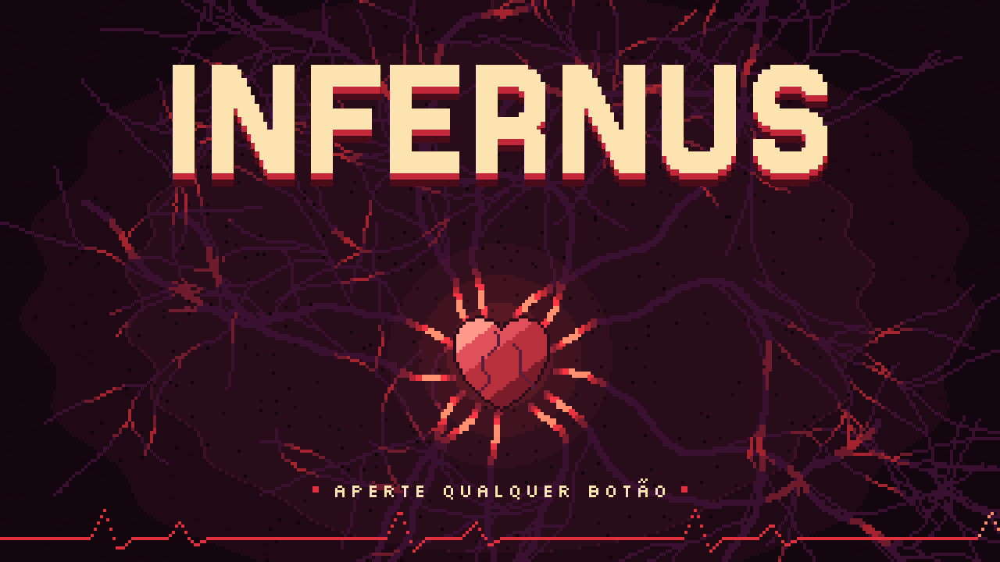

# Infernus



Metroidvania 2D em pixel art feito com Python e Pygame. Uma garota anja acorda
sem memórias numa terra pútrida e deserta, tendo um escudo como única defesa.
Vozes clamam por ajuda. Quem te trouxe aqui? Quem precisa de você?

## Sobre o jogo

- **Mundo:** a aventura acontece dentro de um corpo. Cada sala é um órgão (boca,
  pulmões, coração), o coração liga as regiões e o chefe final é um cérebro com
  um olho no centro.
- **Combate:** o escudo é arma e defesa. A protagonista avança com ele numa
  investida (dash) que causa dano e empurra, e faz parry para paralisar o
  inimigo.
- **Visual:** a protagonista tem cores claras e quentes e funciona como uma luz.
  O cenário é escuro e frio, em roxos e vinhos.
- **Escopo:** uma única área, com 3 inimigos, 1 chefe, 2 ou 3 escudos e no
  mínimo 1 habilidade.
- **Inspirações:** Hollow Knight e The Binding of Isaac.

O design completo, com as imagens de referência, está em
[docs/GDD.md](docs/GDD.md).

## Como jogar

| Ação                         | Tecla                       |
| ---------------------------- | --------------------------- |
| Começar (na tela de título)  | Qualquer tecla, clique ou botão de controle |
| Andar                        | A/D ou setas esquerda/direita |
| Pular                        | Espaço (segure para pular mais alto) |
| Dash com escudo              | E                           |
| Parry                        | W ou seta para cima         |

Enquanto a arte final não entra no jogo, os personagens são retângulos que mudam
de cor conforme o estado:

- **Jogador:** amarelo normal, ciano no dash, laranja com o dash recarregando,
  magenta no parry, e pisca em branco quando está invulnerável depois de levar
  dano.
- **Inimigo:** vermelho normal, pisca em branco cada vez mais rápido antes de
  atacar e fica amarelo quando está atordoado.

## Executar

No terminal, dentro da pasta do projeto.

Windows (PowerShell):

```powershell
py -m venv .venv
.\.venv\Scripts\Activate.ps1
python -m pip install -r requirements.txt
python main.py
```

Linux e macOS:

```bash
python3 -m venv .venv
source .venv/bin/activate
python -m pip install -r requirements.txt
python main.py
```

Também dá para rodar com `python -m infernus`. Para ver só a tela de título, use
`python -m infernus.telas.titulo`. Para sair, feche a janela.

### Testes

```bash
python -m pip install pytest
python -m pytest
```

Para rodar sem abrir janela (em CI, por exemplo), defina
`SDL_VIDEODRIVER=dummy`.

## Como o jogo funciona

1. `main.py` chama `infernus/jogo.py`, que inicia o Pygame e abre a janela de
   1280×720 a 60 FPS (valores em `infernus/config.py`).
2. A **tela de título** (`infernus/telas/titulo.py`) roda até alguém apertar um
   botão. Se a janela for fechada, o jogo termina.
3. A **fase de teste** (`infernus/fases/fase_teste.py`) roda o loop da gameplay.
   A cada quadro ela:
   1. lê o teclado;
   2. atualiza o jogador;
   3. monta a hitbox do dash e verifica os acertos;
   4. atualiza o inimigo, que devolve a área do ataque quando ataca;
   5. aplica o dano por contato e resolve o ataque contra o parry;
   6. desenha a cena.

## Estrutura do projeto

```
main.py                  atalho para iniciar o jogo
infernus/                pacote do jogo
  jogo.py                abre a janela e encadeia tela de título e fase
  config.py              resolução, FPS, título da janela e caminhos de assets
  entidades/
    jogador.py           movimento, pulo, dash, parry, vida, knockback
    inimigo.py           Inimigo 1: persegue, prepara, ataca, atordoa, morre
    alvo_teste.py        alvo parado para validar o dash
  combate/
    hitbox.py            área de acerto à frente do jogador durante o dash
    ataque_dash.py       dano e empurrão da investida nos alvos
    parry.py             resolve o ataque do inimigo contra o parry
  telas/
    titulo.py            tela de título (coração pulsante)
  fases/
    fase_teste.py        fase de testes do combate
assets/fonts/            fontes da interface (licença SIL OFL)
docs/
  GDD.md                 Game Design Document
  referencias/           imagens de referência do GDD
  imagens/               imagens do README
tests/                   testes automatizados (pytest)
CLAUDE.md                contexto do projeto e convenções do código
```

Onde colocar cada coisa nova:

- Personagem ou objeto com estado próprio: `infernus/entidades/`.
- Regra de combate entre entidades: `infernus/combate/`.
- Cada sala ou órgão do mapa: um módulo em `infernus/fases/`.
- Menus e telas fora da gameplay: `infernus/telas/`.
- Imagens, sons e fontes: `assets/`, lidos pelos caminhos de `config.py`.

## Mecânicas

Os valores citados abaixo são constantes no topo de cada módulo. Mudar o número
ali muda o comportamento no jogo.

### Movimento e pulo

O pulo tem *coyote time* (`COYOTE_TIME`): dá para pular logo depois de sair da
plataforma. Também tem *jump buffer* (`JUMP_BUFFER_TIME`): apertar pouco antes
de tocar o chão ainda conta. Soltar o Espaço cedo corta o pulo
(`JUMP_CUT_MULTIPLIER`). Valores em `infernus/entidades/jogador.py`.

### Dash

O dash tem duração de `DASH_DURATION` e cooldown de `DASH_COOLDOWN`, ambos em
`infernus/entidades/jogador.py`. Durante o cooldown o personagem aparece em
laranja e o dash não pode ser iniciado.

Durante o dash, uma hitbox translúcida à frente do personagem pode atingir cada
alvo uma vez por investida, aplicando `DASH_DAMAGE` e o knockback
`DASH_KNOCKBACK` (em `infernus/combate/ataque_dash.py`). Acertar o inimigo
interrompe a investida na hora e posiciona o jogador antes dele, sem
atravessá-lo. O cooldown do dash é preservado. O alvo de teste existe para
validar essa integração.

### Parry

O parry abre uma janela de `PARRY_DURATION` e muda a cor do personagem. Aparar
no momento do acerto impede o dano e atordoa o inimigo por `STUN_DURATION`. Fora
da janela, o jogador recebe dano. Inimigos atordoados não se movem nem atacam.

### Dano, knockback e invulnerabilidade

Ao receber dano, o jogador entra em knockback: `KNOCKBACK_SPEED`,
`KNOCKBACK_VERTICAL_FORCE` e `KNOCKBACK_DURATION`, em
`infernus/entidades/jogador.py`, controlam a força e a duração. Durante esse
estado o impulso respeita a gravidade e as colisões, mas o controle horizontal
fica bloqueado até a recuperação automática. Depois do dano, o jogador fica
invulnerável por `INVULNERABILITY_DURATION` e pisca em branco. Encostar no
inimigo também causa dano.

### Inimigo 1

Anda devagar até o jogador e, ao chegar perto, prepara o ataque
(`ENEMY_ATTACK_WINDUP`), piscando cada vez mais rápido. Depois avança com um
leve dash e se recupera antes de poder atacar de novo. Tem `MAX_ENEMY_HEALTH`
de vida, para de agir enquanto é empurrado ou está atordoado e morre quando a
vida chega a zero. Valores em `infernus/entidades/inimigo.py`.

## Tela de título

A tela de título é a câmara do coração, a sala central do mapa. Ela surge do
preto com um fade suave, já com o título e o "APERTE QUALQUER BOTÃO". O coração
bate em ritmo dobrado ("tum-tum"). Cada batida manda um pulso de luz pelas veias
da câmara, desenha um pico no eletrocardiograma e faz o título pulsar. Qualquer
tecla, clique ou botão de controle escurece a tela e inicia o jogo.

A cena é desenhada em 320×180 e ampliada 4× para 1280×720, para que todos os
pixels tenham o mesmo tamanho. Os tempos, as cores e as posições são constantes
no topo de `infernus/telas/titulo.py`.

## Situação do projeto

| Pronto | Falta |
| ------ | ----- |
| Resolução, movimento, pulo e colisão com plataformas | Arte final (hoje são retângulos) |
| Dash com hitbox e parry | Estado de falha (vida zerada) |
| Sistema de vida, dano e knockback | Inimigos 2 e 3 e o chefe cérebro |
| Inimigo 1 completo | Salas do corpo (level design) |
| Tela de título | Escudos e habilidade |

O roadmap completo está no [GDD](docs/GDD.md#roadmap).

## Contribuindo

- Leia o [CLAUDE.md](CLAUDE.md): ele tem o contexto do jogo, as decisões em
  aberto e as convenções do código. É também o arquivo que o Claude lê ao
  trabalhar no projeto.
- Crie uma branch por mudança (`feat/...`, `fix/...`, `refactor/...`,
  `docs/...`) e abra um Pull Request para a `main`.
- Commits no padrão Conventional Commits, em português (`feat: ...`,
  `fix: ...`).
- Rode `python -m pytest` antes de abrir o PR e nunca commite marcadores de
  conflito (`<<<<<<<`).

## Créditos

- Fonte [Jersey 25](https://fonts.google.com/specimen/Jersey+25), da Soft Type
  Project, sob a SIL Open Font License 1.1 (`assets/fonts/OFL-Jersey25.txt`).
- Fonte [Silkscreen](https://fonts.google.com/specimen/Silkscreen), da
  Silkscreen Project, sob a SIL Open Font License 1.1
  (`assets/fonts/OFL-Silkscreen.txt`).
