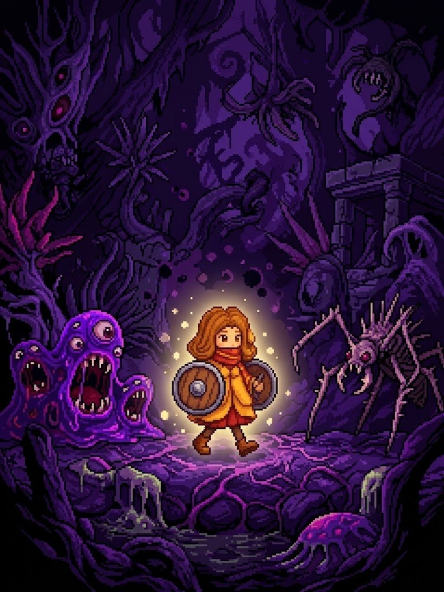
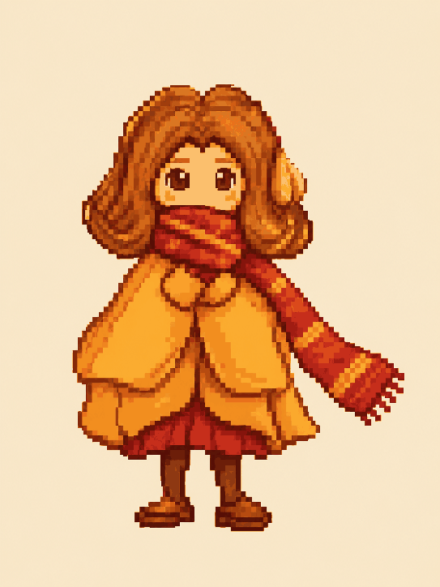
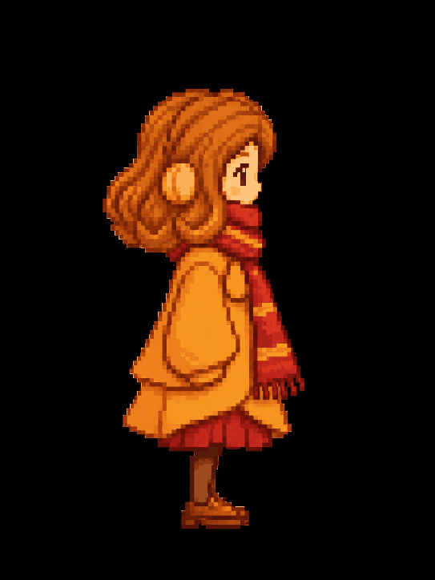
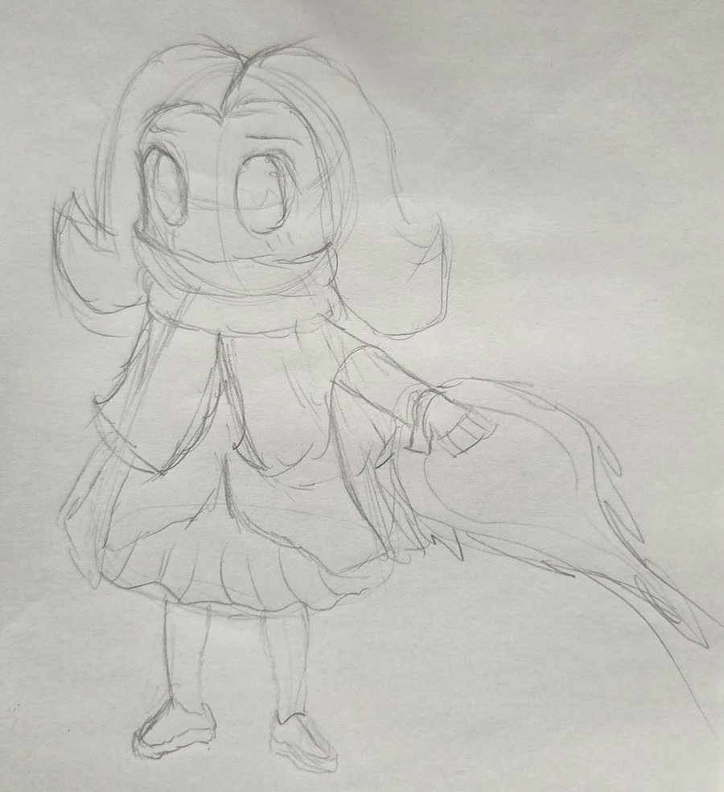
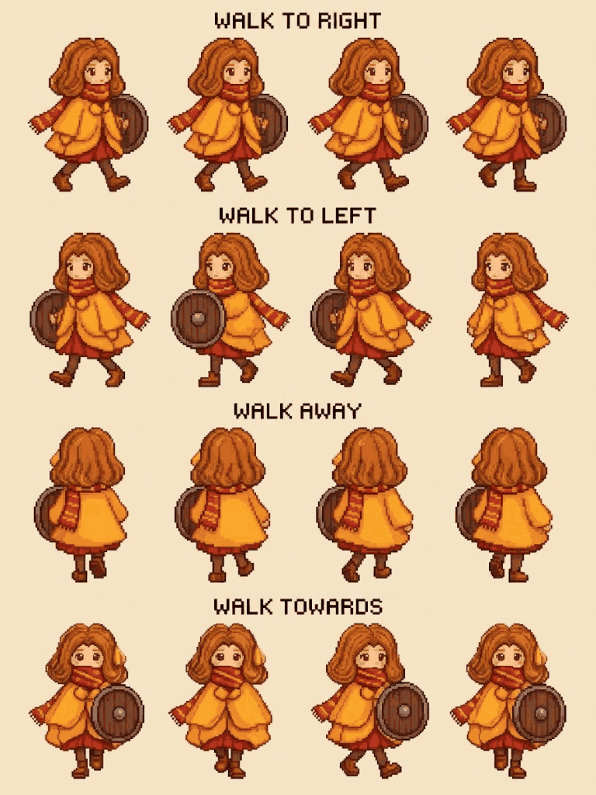
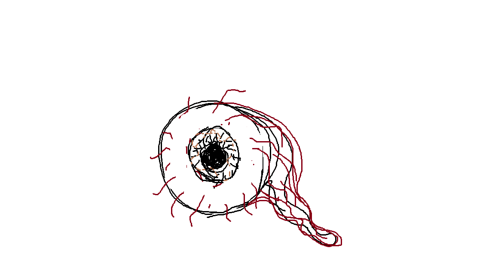
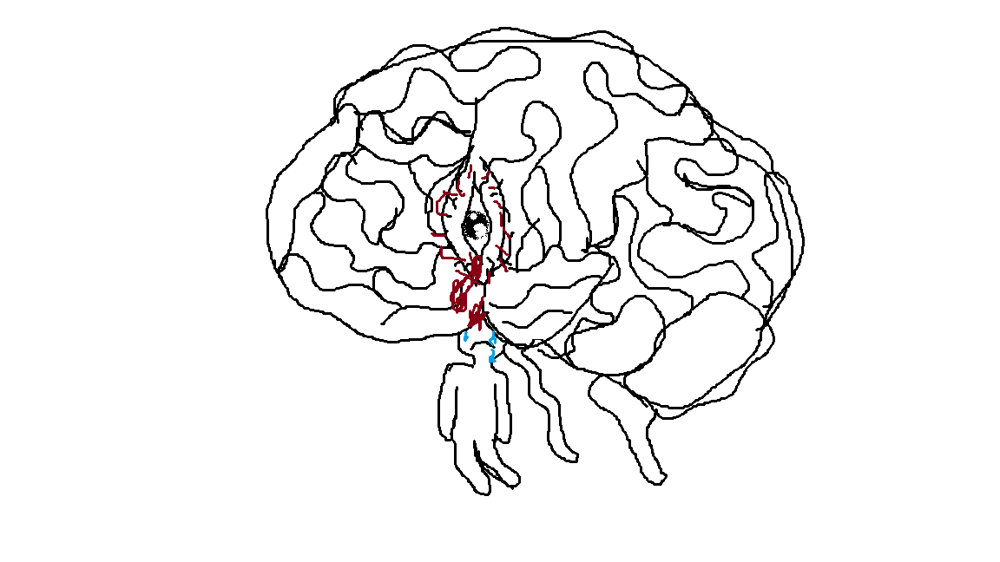
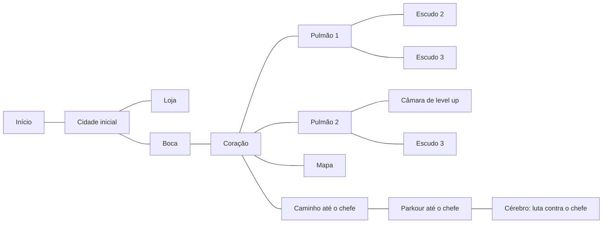
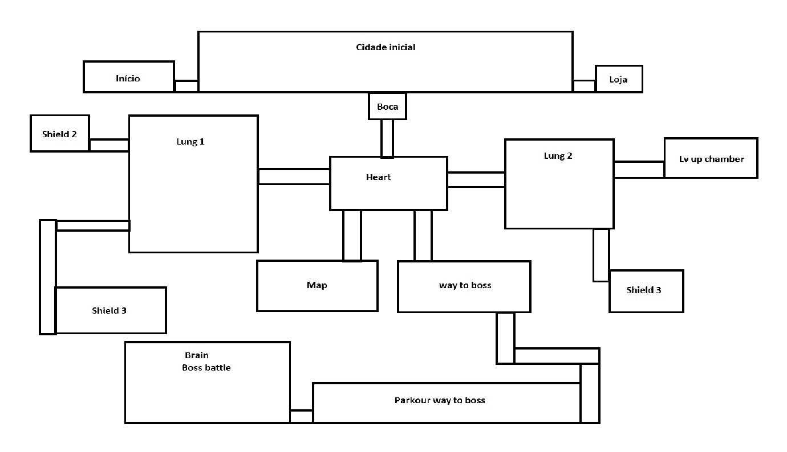

# Infernus — Game Design Document

Versão em Markdown do GDD do projeto, mantida junto ao código. Onde o GDD
original ainda não define algo, o item aparece como **a definir**.

## Visão geral

Infernus é um Metroidvania 2D sobre uma garota anja que acorda sem suas
memórias em uma terra pútrida e deserta, tendo como única defesa um escudo.

## Escopo

Por ser um Metroidvania, o jogo naturalmente pediria muito conteúdo
(cenários, itens, bestiário, habilidades). Para este projeto, o foco é
construir **uma única área**, com poucas salas, inimigos e no máximo um
chefe:

| Conteúdo    | Quantidade  |
| ----------- | ----------- |
| Inimigos    | 3           |
| Chefe       | 1           |
| Armas       | 2 ou 3 (escudos) |
| Habilidades | no mínimo 1 |

## Inspirações

- **Hollow Knight:** exploração, mapa interligado e atmosfera melancólica.
- **The Binding of Isaac:** temática orgânica e grotesca e inimigos
  perturbadores.

## Tecnologia

| Item       | Escolha                                        |
| ---------- | ---------------------------------------------- |
| Linguagem  | Python                                         |
| Biblioteca | Pygame (o projeto usa o `pygame-ce`, ver `requirements.txt`) |
| Resolução  | 1280×720                                       |

## Apresentação

### Direção de arte

- Pixel art.
- **Contraste entre personagem e cenário:** a protagonista tem tons claros e
  quentes e funciona como uma fonte de luz. O resto do mundo é escuro, com
  cores frias.
- O cenário é orgânico e apodrecido, em roxos e vinhos, com carne, veias e
  olhos.

### Protagonista

Garota anja de cabelo ruivo e volumoso, com um cachecol vermelho de listras
amarelas cobrindo a boca, casaco amarelo-alaranjado, saia vermelha, meias e
botas marrons e um escudo redondo de madeira. O GDD já tem a sprite sheet de
caminhada em quatro direções (direita, esquerda, de costas e de frente).

| De frente | De perfil | Esboço |
| --------- | --------- | ------ |
|  |  |  |

## História e narrativa

### Sinopse

A anja (ou humana) acorda sem suas memórias, mas vozes clamam por ajuda numa
terra pútrida e deserta. Quem te trouxe aqui? Quem precisa de você? Encontre
as respostas.

## Gameplay

### Moveset

- Mover para a esquerda e para a direita.
- Pular.
- Investida com escudo para a esquerda e para a direita, causando dano e
  knockback no impacto.
- Parry que deixa o inimigo paralisado por alguns segundos.

O escudo é ao mesmo tempo **arma e defesa**.

### Combate

- O jogador recebe dano ao encostar no inimigo.
- Cada investida bem-sucedida causa 1 ponto de dano.

### Inimigos

| Inimigo   | Comportamento |
| --------- | ------------- |
| Inimigo 1 | Move-se lentamente em direção ao jogador, tem 3 pontos de vida e de tempos em tempos faz um ataque na direção do jogador (um leve dash). |
| Inimigo 2 | A definir. |
| Inimigo 3 | A definir. |

Conceito em aberto: **inimigo olho**, um globo ocular com veias vermelhas e
um nervo pendurado.

### Chefe

Um **cérebro** com um olho no centro e uma figura presa a ele por veias. A
luta acontece na sala do cérebro, no fim da área.

## Mapa

A área se passa **dentro de um corpo**: as salas são órgãos. O coração é o
ponto central que liga as outras regiões.

> O rascunho do mapa no GDD coloca um "Shield 3" ligado ao Pulmão 1 e outro
> ligado ao Pulmão 2. Falta definir se são o mesmo escudo ou se um deles é
> outro item.

## Tela de título

Implementada em `infernus/telas/titulo.py`.

- **Conceito:** a tela é a câmara do coração, o centro do mapa. Um coração
  em pixel art bate no meio, e cada batida manda um pulso de luz pelas veias
  da câmara. Uma linha de eletrocardiograma corre embaixo.
- **Sequência:**
  1. **0 a 2,5 s:** a tela inteira surge do preto com um fade suave, com o
     coração, o título e o "APERTE QUALQUER BOTÃO" juntos.
  2. **1,2 s:** primeira batida. A partir daí o ritmo é dobrado ("tum-tum"),
     a cerca de 70 batidas por minuto. O título pulsa e o aviso acende a cada
     batida.
- **Qualquer botão** vale tecla, clique do mouse ou botão de controle. Apertar
  escurece a tela com um fade e inicia o jogo.
- **Pixel art:** a cena é desenhada em 320×180 e ampliada 4× para 1280×720,
  para que todos os pixels tenham o mesmo tamanho.
- **Fontes:** Jersey 25 no título e Silkscreen no aviso, as duas sob a
  licença SIL Open Font License, em `assets/fonts/`.

## Roadmap

| #  | Etapa                                   | Situação no código |
| -- | --------------------------------------- | ------------------ |
| 1  | Definir resolução                       | Feito (1280×720) |
| 2  | Movimentação básica (andar e pular)     | Feito, com coyote time e jump buffer |
| 3  | Colisão básica com objetos              | Feito (plataformas de teste) |
| 4  | Ataques e parry do personagem           | Feito (dash com hitbox e parry) |
| 5  | Desenhar inimigo                        | Placeholder (retângulo) |
| 6  | Movimentação do inimigo                 | Feito (Inimigo 1) |
| 7  | Colisão de ataque com inimigo           | Feito |
| 8  | Sistema de vida                         | Feito (jogador e inimigo) |
| 9  | Colisão de dano com inimigo             | Feito |
| 10 | Estado de falha                         | A fazer |
| 11 | Montar os 3 inimigos                    | 1 de 3 |
| 12 | Level design                            | A fazer |
| —  | Tela de título                          | Feito |
